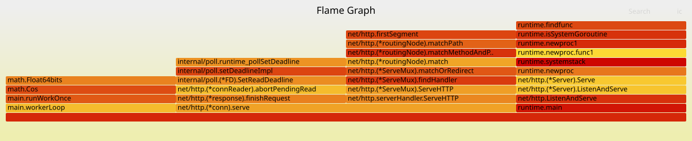
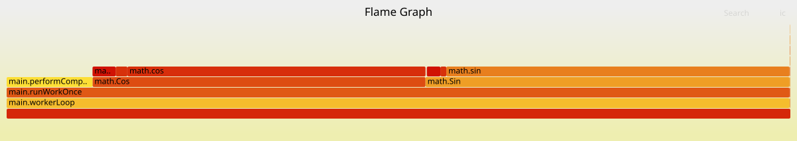

# pprof-demo

`pprof-demo` is a small Go HTTP service that continuously executes synthetic work while exposing Go's built-in `pprof` endpoints. It is intended to showcase how a performance engineer can toggle a regression at runtime (via environment variables) and capture CPU or memory flame graphs across two different configurations.

## Features
- Background worker that performs CPU-intensive math operations by default.
- Optional intentional regressions controlled by environment variables:
  - `BUG_MODE=cpu` ramps up tight inner loops to burn CPU cycles.
  - `BUG_MODE=memory` retains byte slices to simulate a memory leak.
  - `BUG_MODE=mixed` combines both behaviours.

## Prerequisites

- Clone kube-burner and build the binary (needed for profile collection):
  ```bash
  git clone https://github.com/kube-burner/kube-burner.git
  cd kube-burner
  make build
  cd ..
  ```
- Clone Brendan Gregg’s FlameGraph scripts (used to render the SVGs):
  ```bash
  git clone https://github.com/brendangregg/FlameGraph.git
  ```
- Keep the `kube-burner/`, `FlameGraph/`, and `kube-burner-demo-for-performance-engineers/` directories side by side (same parent folder) so the relative paths used throughout this guide continue to work.
- Ensure you have recent versions of Go, Docker, and Kind (or another Kubernetes cluster) installed on your workstation.

## Container image

Build and push (or load into your cluster) an image that embeds the compiled binary and `curl`, which kube-burner needs when it execs into the pod:

```bash
cd kube-burner-demo-for-performance-engineers
docker build -t kind.local/pprof-demo:latest -f Containerfile .
```

Replace the image reference under `deploy/deployment.yaml` (default `kind.local/pprof-demo:latest`) with the one you build/push.

With the image ready, bring up a Kind cluster (skip if you already have one) and load the local image into it:

```bash
kind create cluster --name kube-burner-demo-for-performance-engineers
kind load docker-image kind.local/pprof-demo:latest --name kube-burner-demo-for-performance-engineers
```

## Kubernetes deployment workflow

```bash
# Apply the namespace, service, and deployment
kubectl apply -f deploy/namespace.yaml
kubectl apply -f deploy/service.yaml
kubectl apply -f deploy/deployment.yaml

# Baseline release X
kubectl set env deployment/pprof-demo -n pprof-demo BUG_MODE=none BUG_MULTIPLIER=0 WORK_ITERATIONS=500

# Intentional regression release Y
kubectl set env deployment/pprof-demo -n pprof-demo BUG_MODE=cpu BUG_MULTIPLIER=8 WORK_ITERATIONS=6000
# ... or switch to BUG_MODE=memory BUG_MULTIPLIER=20 for a memory leak scenario.
```

Give the pod a few seconds after each change so the background worker can warm up before you collect profiles.

## Collecting profiles with kube-burner

1. Build kube-burner (from the sibling `kube-burner/` repository):
   ```bash
   cd ../kube-burner
   make build
   ```
   The binary lands in `bin/kube-burner`.

2. From `kube-burner-demo-for-performance-engineers/`, collect profiles for the active deployment:
   ```bash
   cd ../kube-burner-demo-for-performance-engineers
   ../kube-burner/bin/kube-burner init --config kube-burner-run.yaml --uuid pprof-demo-baseline
   ```

   - Change the deployment env vars to simulate release Y, then rerun with a new UUID (for example `pprof-demo-regression`).
   - Captured `.pprof` files will be stored under `kube-burner-demo-for-performance-engineers/profiles/`.

If you need profiles on a faster cadence, edit `pprofInterval` inside `kube-burner-run.yaml`.

## Flame graph generation flow

1. Convert the collected `.pprof` files into raw format:
   ```bash
   cd profiles
   go tool pprof -raw -output baseline-cpu.pprof pprof-demo-cpu-<pod>-<timestamp>.pprof
   go tool pprof -raw -output regression-cpu.pprof pprof-demo-cpu-<pod>-<timestamp>.pprof
   ```

2. Produce SVG flame graphs using the [FlameGraph](../FlameGraph) scripts:
   ```bash
   cat baseline-cpu.pprof | ../FlameGraph/stackcollapse-go.pl | ../FlameGraph/flamegraph.pl > baseline-cpu.svg
   cat regression-cpu.pprof | ../FlameGraph/stackcollapse-go.pl | ../FlameGraph/flamegraph.pl > regression-cpu.svg
   ```

3. Compare the SVGs side-by-side. Wider stacks in release Y (for example around `performComputation`) highlight the intentional regression.

### When you finish the walkthrough, clean up the cluster:
```bash
kind delete cluster --name kube-burner-demo-for-performance-engineers
```

---

## Demo Flow Example

To have a clean run, please delete the profiles folder (I just have them in-place as a reference of generated artifacts during the demo run) before starting with the below commands.

The following commands show a complete “release X vs release Y” capture using Kind and local images (run from the repo root, also for #6, do not forget to replace the .pprof file names with the one's that are collected in the previous steps):

```bash
# 1. Build the container image (inside kube-burner-demo-for-performance-engineers/)
cd kube-burner-demo-for-performance-engineers
docker build -t kind.local/pprof-demo:latest -f Containerfile .

# 2. Stand up a Kind cluster and load the image
kind create cluster --name kube-burner-demo-for-performance-engineers
kind load docker-image kind.local/pprof-demo:latest --name kube-burner-demo-for-performance-engineers

# 3. Deploy the app
kubectl apply -f deploy/namespace.yaml
kubectl apply -f deploy/service.yaml
kubectl apply -f deploy/deployment.yaml
kubectl get pods -n pprof-demo

# 4. Baseline run (release X)
kubectl set env deployment/pprof-demo -n pprof-demo BUG_MODE=none BUG_MULTIPLIER=0 WORK_ITERATIONS=500
kubectl rollout status deployment/pprof-demo -n pprof-demo
../kube-burner/bin/kube-burner init --config kube-burner-run.yaml --uuid pprof-demo-baseline

# 5. Regression run (release Y – CPU example)
kubectl set env deployment/pprof-demo -n pprof-demo BUG_MODE=cpu BUG_MULTIPLIER=8 WORK_ITERATIONS=6000
kubectl rollout status deployment/pprof-demo -n pprof-demo
../kube-burner/bin/kube-burner init --config kube-burner-run.yaml --uuid pprof-demo-regression

# 6. Convert profiles (inside kube-burner-demo-for-performance-engineers/profiles/)
cd profiles
go tool pprof -raw -output baseline-cpu.pprof pprof-demo-cpu-pprof-demo-<baseline-pod>-<timestamp>.pprof
go tool pprof -raw -output regression-cpu.pprof pprof-demo-cpu-pprof-demo-<regression-pod>-<timestamp>.pprof

# 7. Create flame graphs (FlameGraph scripts live two directories up)
cat baseline-cpu.pprof   | ../../FlameGraph/stackcollapse-go.pl | ../../FlameGraph/flamegraph.pl > baseline-cpu.svg
cat regression-cpu.pprof | ../../FlameGraph/stackcollapse-go.pl | ../../FlameGraph/flamegraph.pl > regression-cpu.svg
```

Open the generated SVGs in a browser to compare release X (baseline) and release Y (intentional regression). Repeat steps 6–7 for the heap profiles if you want memory flame graphs as well.

```bash
# 8. Tear everything down when you are done
kind delete cluster --name kube-burner-demo-for-performance-engineers
```

### Sample Output

These flame graphs were produced by running the demo flow above inside Kind and collecting profiles with kube-burner:





In the baseline Flamegraph (top image - baseline CPU) you see lots of thinner bars from different pieces of the server doing small bits of work. After we change the env vars to `BUG_MODE=cpu` with a higher `BUG_MULTIPLIER`, the Flamegraph (bottom image - regression CPU) changes as there is one huge section that shows up from the math loop in `performComputation` (the calls to `math.Sin` and `math.Cos`). That wide block is the slowdown we injected, so you can point at it and say “release Y is burning a lot more CPU than release X.”

You can also go through their raw outputs in the profiles directory. I have all the artifacts that are generated during the demo run in-place inside the profiles folder. You can clear all of them before your run to avoid any confusion.
